# Anleitung für Mitspieler

Mit dem **Team & Build Manager** hältst du deine Genshin-Impact-Teams und die Builds deiner Charaktere an einem Ort fest: Level, Sternbild, Talente, Waffe, Artefaktsets und die Werte aller fünf Artefakte. Du kannst ihn im **Browser** oder als **Android-App** (Handy und Tablet) nutzen; beides greift auf dasselbe Konto zu.

  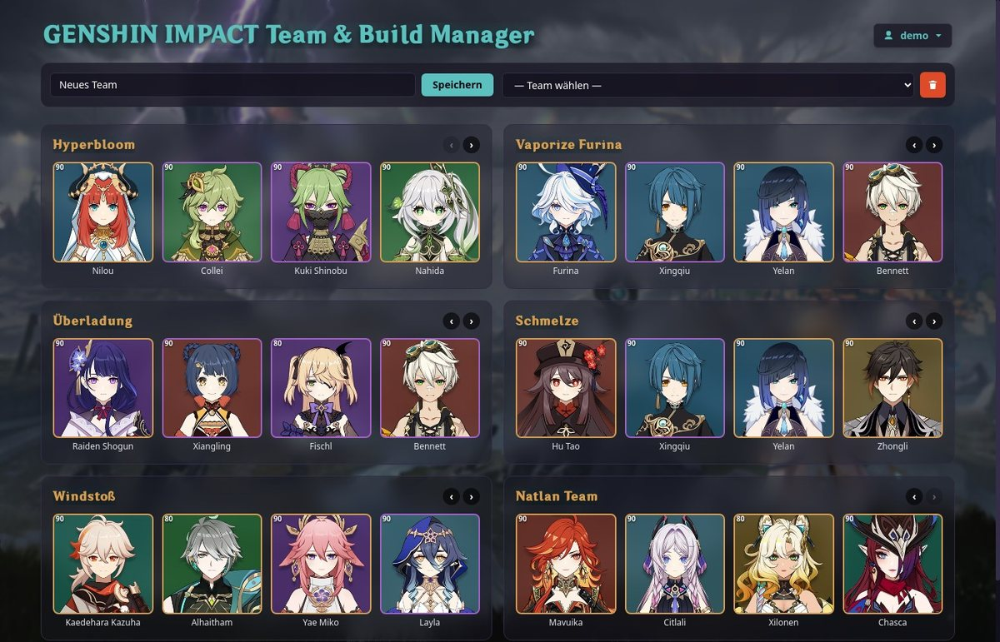

Die Bilder in dieser Anleitung zeigen Beispieldaten eines Demo-Kontos.

Eine Technik-Beschreibung für Entwickler steht in der [README](README.md).

**Inhalt:** [Loslegen](#loslegen) · [Teams und Builds](#teams-und-builds) · [Android-App](#android-app) · [Konto löschen](#konto-löschen) · [Über-Dialog und Version](#über-dialog-und-version) · [Daten mitnehmen](#daten-mitnehmen-oder-übertragen) · [Desktop-Version](#desktop-version-optional) · [Wenn etwas nicht klappt](#wenn-etwas-nicht-klappt)

## Loslegen

1. **Konto anlegen:** Öffne <https://genshin-manager.media-matrix.de> und wähle „Jetzt registrieren“. Der Benutzername braucht mindestens 3 Zeichen, das Passwort mindestens 6.
2. **Anmelden** mit demselben Konto, im Browser oder in der App.
3. **Teams anlegen:** Ein Team besteht aus bis zu 4 Charakteren. Name vergeben, Charaktere aus der Liste wählen (mit Suche), speichern.
4. **Builds pflegen:** Öffne in einem Team einen Charakter und lege seinen Build an oder bearbeite ihn.

<table>
  <tr>
    <td align="center">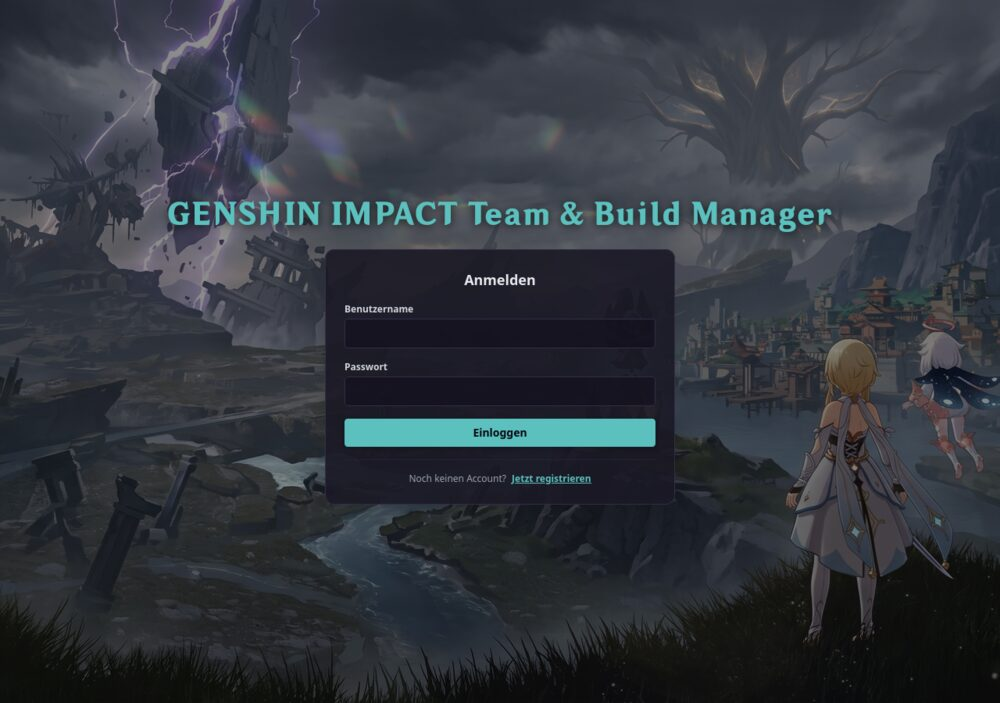 Anmeldung im Browser</td>
    <td align="center">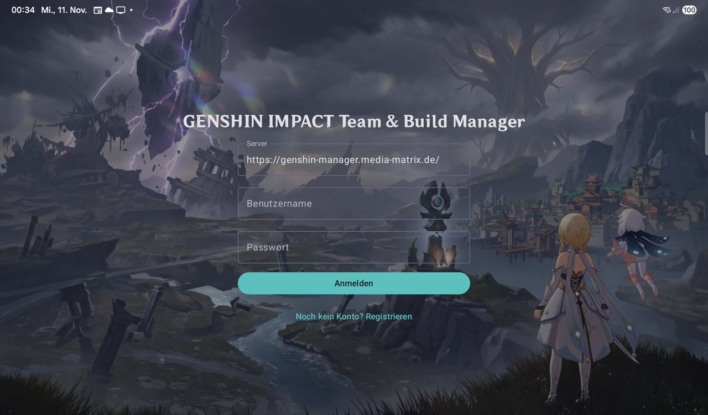 Anmeldung in der App</td>
  </tr>
</table>

In der App ist das Feld **„Server“** schon mit `https://genshin-manager.media-matrix.de/` ausgefüllt. Lass es so, es sei denn, du hast ausdrücklich eine andere Adresse bekommen. Ein Konto kannst du dort auch direkt über „Noch kein Konto? Registrieren“ anlegen.

## Teams und Builds

- **Ein Build gehört zum Charakter, nicht zum Team.** Steht Furina in drei Teams, hat sie überall denselben Build. Änderst du ihn, ändert er sich in allen Teams.
- **Teams sortieren:** Mit den Pfeilen auf der Teamkarte verschiebst du Teams; im Browser geht das auch per Drag & Drop. Die Reihenfolge wird gespeichert.
- **Deine Daten sind nur deine:** Jedes Konto sieht nur die eigenen Teams und Builds.

**Im Browser** findest du Alle Teams, Neues Team, Exportieren, Importieren, Logout, Konto löschen und Über im Benutzermenü oben rechts:

  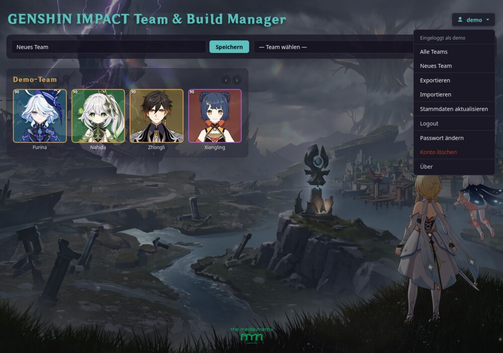

Einen Charakter öffnest du per Klick und trägst Level, Sternbild, Waffe, Artefaktsets und die Werte der fünf Artefakt-Slots ein:

  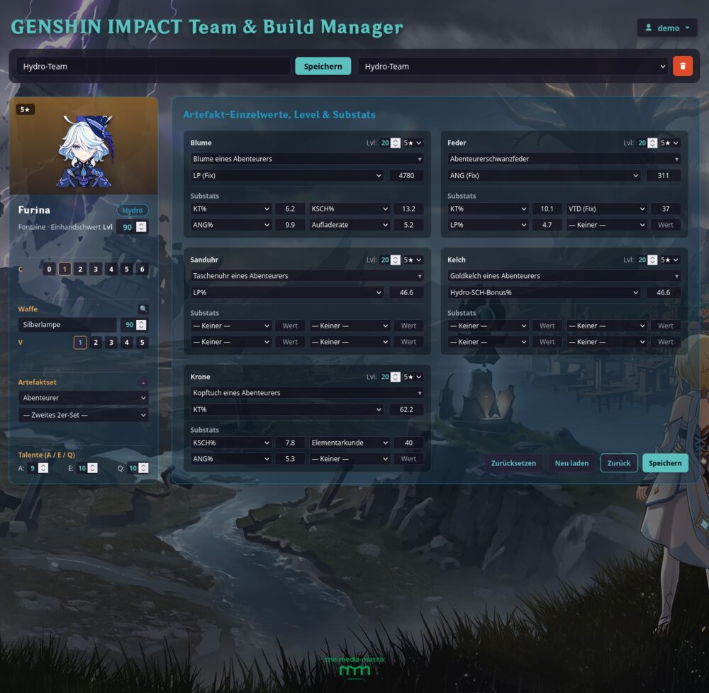

**In der App** tippst du auf einen Charakter, um seinen Build zu sehen, und oben rechts auf „Bearbeiten“, um ihn zu ändern:

<table>
  <tr>
    <td align="center">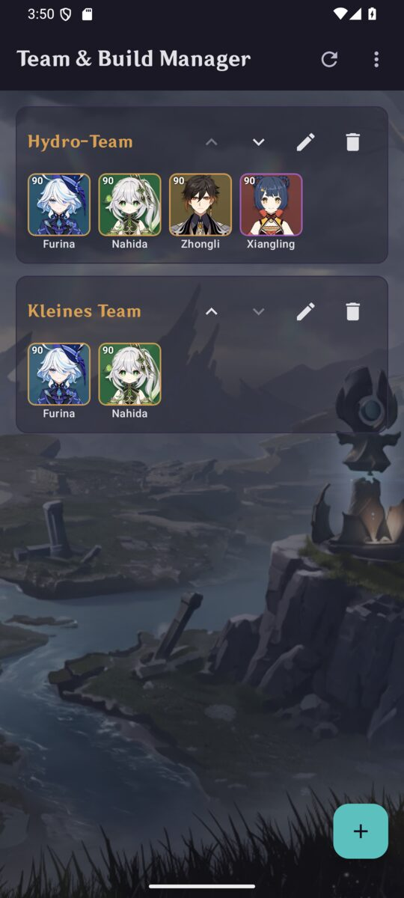 Teams</td>
    <td align="center">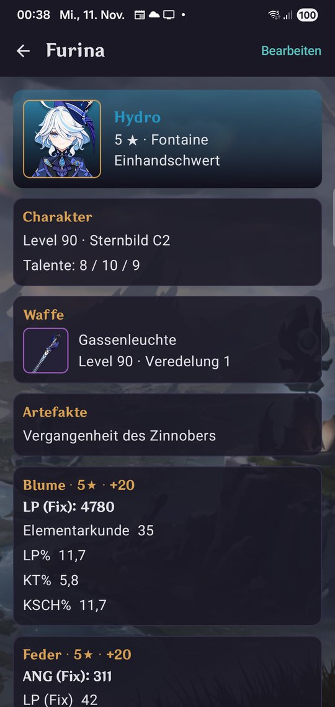 Build ansehen</td>
    <td align="center">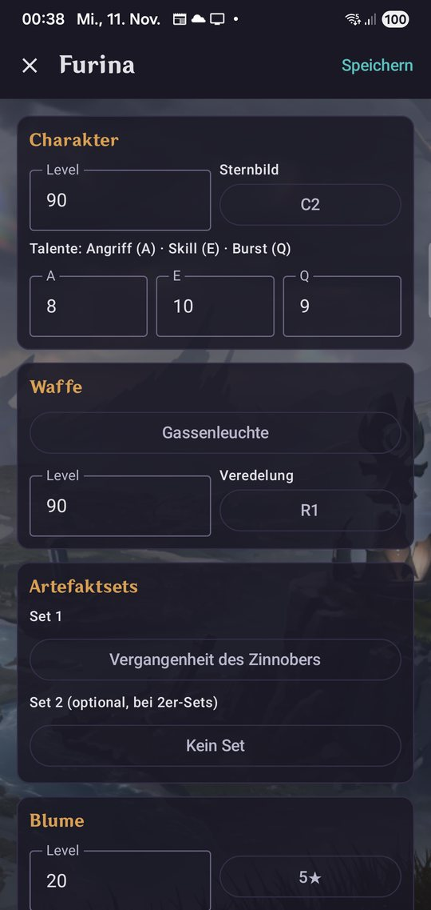 Build bearbeiten</td>
  </tr>
</table>

Beim Verlassen mit ungespeicherten Änderungen fragt die App nach, bevor sie etwas verwirft.

## Android-App

**Voraussetzung:** Android 8.0 oder neuer. Die App gibt es nicht im Play Store; du bekommst die Datei `app-release.apk` direkt von mir.

**Installieren**
1. APK aufs Handy oder Tablet bringen (Messenger, Cloud, USB).
2. Antippen. Android fragt, ob dein Browser bzw. Dateimanager Apps installieren darf; erlaube das für diesen einen Vorgang.
3. App öffnen und mit deinem Konto anmelden (oder dort direkt „Registrieren“ wählen).

**Aktualisieren:** Neue APK einfach über die alte installieren. Deine Anmeldung und Daten bleiben erhalten.

**Handy und Tablet**
- Das **Handy** bleibt im Hochformat, mit einer Spalte.
- Auf dem **Tablet** darf der Bildschirm gedreht werden. Teams stehen dort in zwei (Hochformat) oder drei Spalten (Querformat), Builds zweispaltig, sodass nichts verschenkt wird:

<table>
  <tr>
    <td align="center">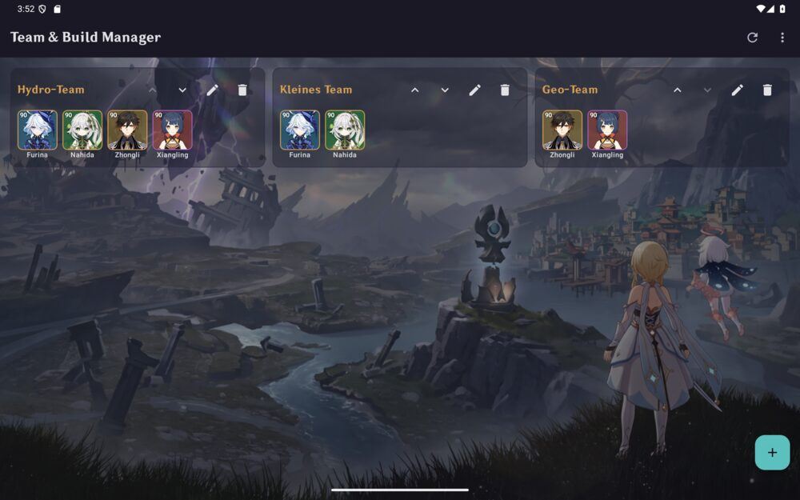 Teams in drei Spalten</td>
    <td align="center">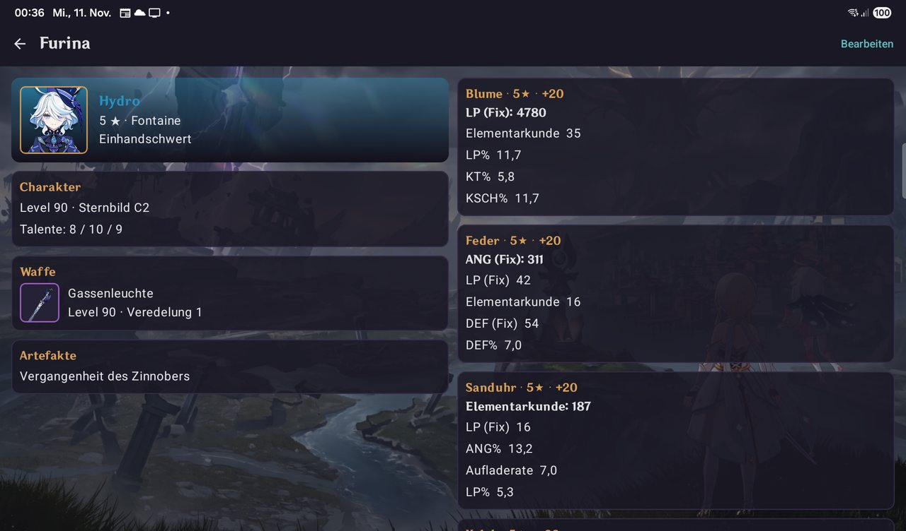 Build zweispaltig</td>
  </tr>
</table>

Beim Bearbeiten stehen die Eingabefelder auf dem Tablet ebenfalls in zwei Spalten, links Charakter, Waffe und Sets, rechts die fünf Artefakt-Slots:

  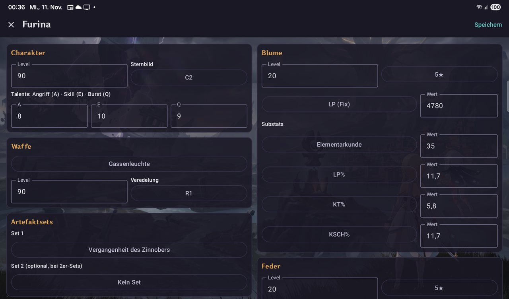

**Menü (⋮ oben rechts):** Abmelden, Über (Version) und Konto löschen. „Neu laden“ (Pfeil daneben) holt den aktuellen Stand vom Server.

  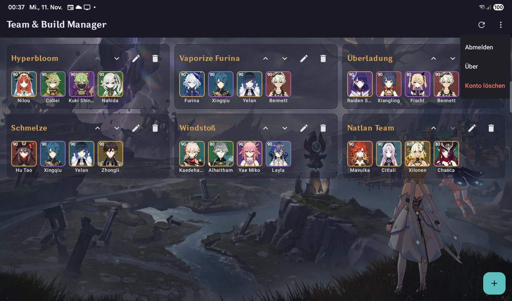

**Ohne Internet:** Die zuletzt geladenen Teams und Builds lassen sich auch offline ansehen. Bearbeiten geht nur mit Verbindung; die App zeigt dann „Offline – Stand vom …“ an. Über „Neu laden“ wird es erneut versucht.

## Konto löschen

Wenn du die App nicht mehr nutzen möchtest, kannst du dein Konto selbst löschen. **Dabei werden dein Konto, alle Teams und alle Builds endgültig entfernt, in Browser und App. Das lässt sich nicht rückgängig machen.**

- **Im Browser:** Benutzermenü oben rechts → „Konto löschen“.
- **In der App:** Menü ⋮ → „Konto löschen“ (nur mit Verbindung).

Du bestätigst mit deinem Passwort. Stimmt es nicht, bleibt alles unverändert und du bekommst die Meldung „Passwort falsch.“. Exportiere vorher, wenn du deine Daten behalten willst (siehe unten).

<table>
  <tr>
    <td align="center">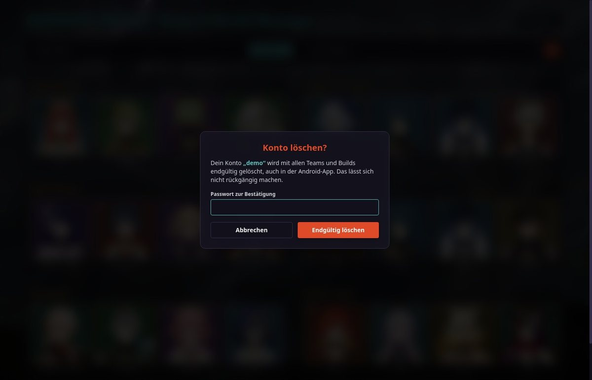 Im Browser</td>
    <td align="center">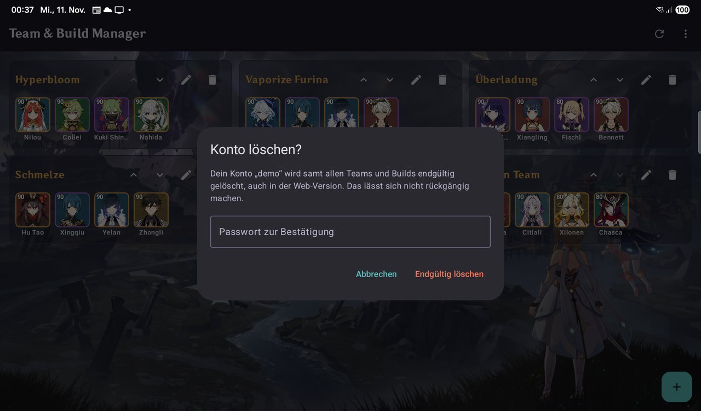 In der App</td>
  </tr>
</table>

**Passwort:** Wähle ein Passwort, das du nirgendwo sonst benutzt. Ein Zurücksetzen oder Ändern des Passworts gibt es derzeit nicht; wer es vergisst, muss ein neues Konto anlegen.

## Über-Dialog und Version

Im Browser (Benutzermenü → „Über“), in der App (Menü ⋮ → „Über“) und am Desktop (Hilfe → „Über…“) zeigt ein kleiner Dialog die **Version**, einen Hinweis zum Fanprojekt und das Logo von the media-matrix. Nenne mir die Version, wenn du einen Fehler meldest: Web, Android und Desktop haben dieselbe Nummer.

<table>
  <tr>
    <td align="center">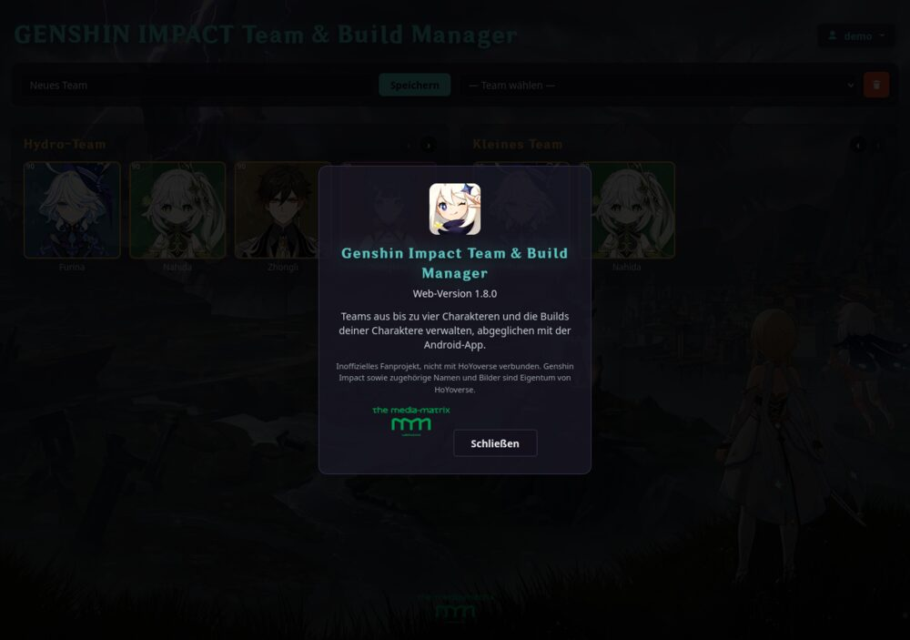 Browser</td>
    <td align="center">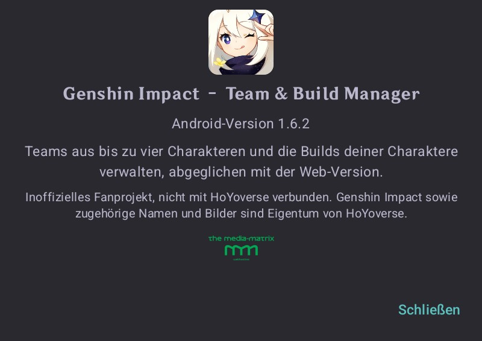 App</td>
    <td align="center">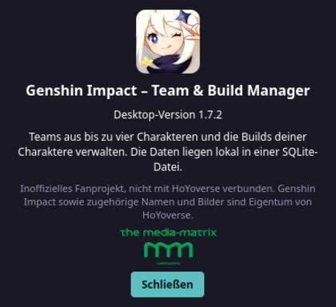 Desktop</td>
  </tr>
</table>

## Daten mitnehmen oder übertragen

Teams und Builds lassen sich als JSON-Datei exportieren und wieder importieren, zum Beispiel zum Sichern oder um Daten aus der Desktop-Version in die Web-Version zu übernehmen. Im Browser findest du beides im Benutzermenü („Exportieren“, „Importieren“), am Desktop im Menü „Datei“.

## Desktop-Version (optional)

Es gibt auch eine Desktop-App, die ihre Daten lokal in einer Datei speichert und **kein Konto** braucht. Sie läuft direkt aus dem Quellcode (Python und PySide6, siehe [desktop/README.md](desktop/README.md)); Builds und Teams lassen sich per JSON-Export mit der Web-Version austauschen.

<table>
  <tr>
    <td align="center">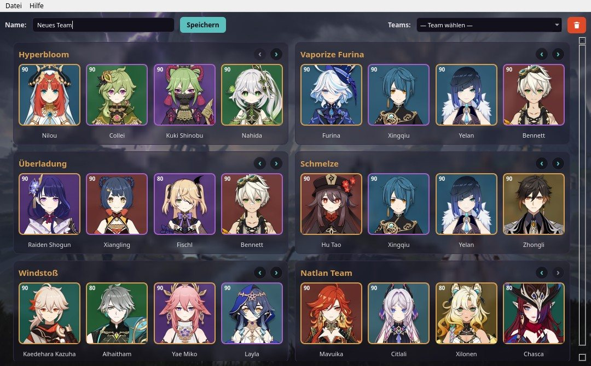 Teamübersicht</td>
    <td align="center">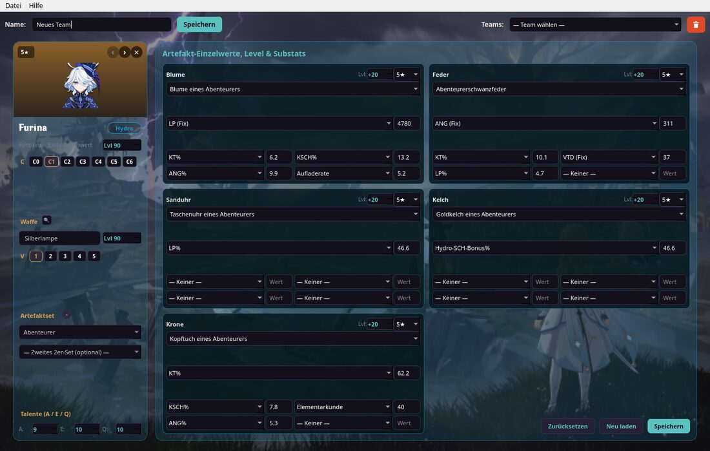 Build eines Charakters</td>
  </tr>
</table>

## Wenn etwas nicht klappt

| Problem | Lösung |
|---|---|
| „Dieser Benutzername ist bereits vergeben“ | Anderen Namen wählen. |
| „Zu viele Versuche“ | Kurz warten; der Server bremst wiederholte Anmeldungen. |
| „Passwort falsch.“ beim Konto löschen | Passwort prüfen; es wird erst bei richtiger Eingabe gelöscht. |
| App zeigt „Offline“ | Internetverbindung prüfen, dann „Neu laden“. |
| Anmeldung in der App schlägt fehl | Prüfe, ob im Feld „Server“ `https://genshin-manager.media-matrix.de/` steht. |
| Installation der APK wird abgelehnt | Installation aus dieser Quelle in den Android-Einstellungen erlauben. |
| Ein Charakter oder eine Waffe fehlt | Bei mir melden; neue Einträge muss ich ergänzen. |

## Hinweis

Inoffizielles Fanprojekt, nicht mit HoYoverse verbunden. Genshin Impact sowie zugehörige Namen und Bilder sind Eigentum von HoYoverse.
