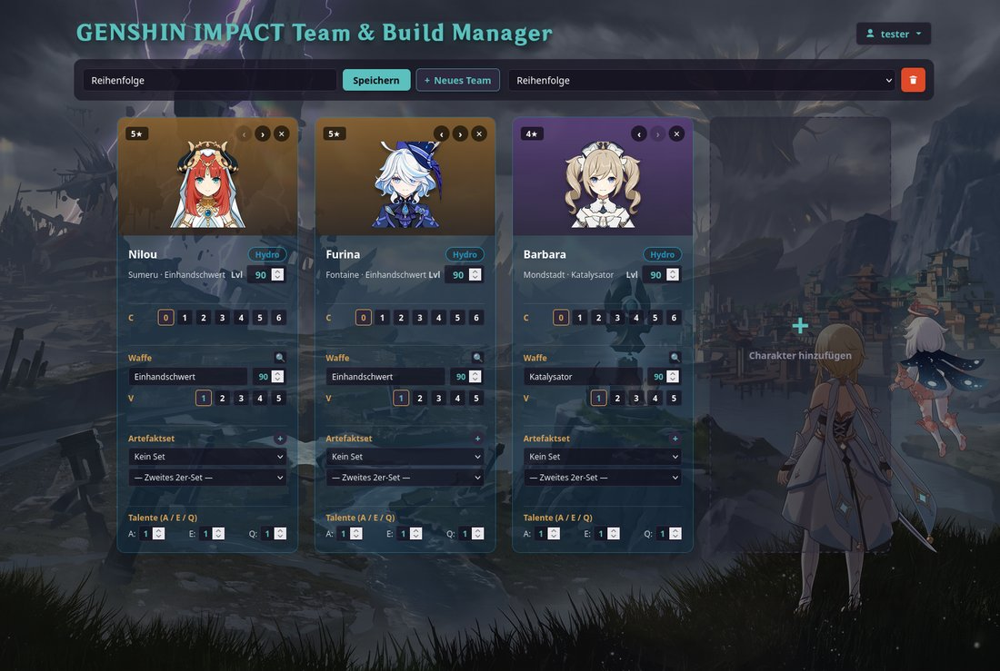
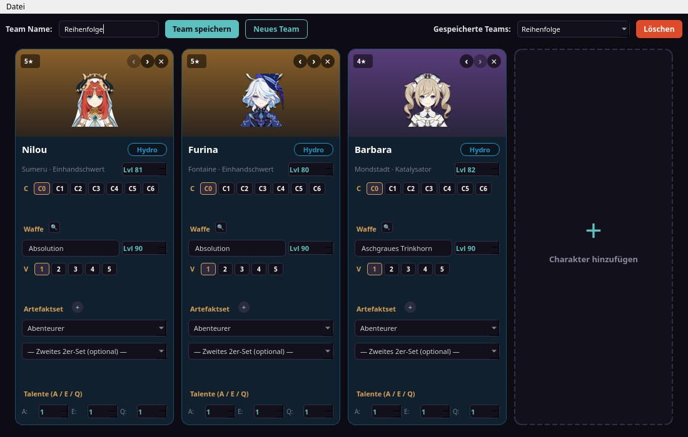
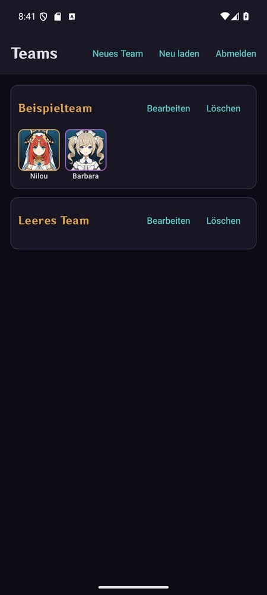
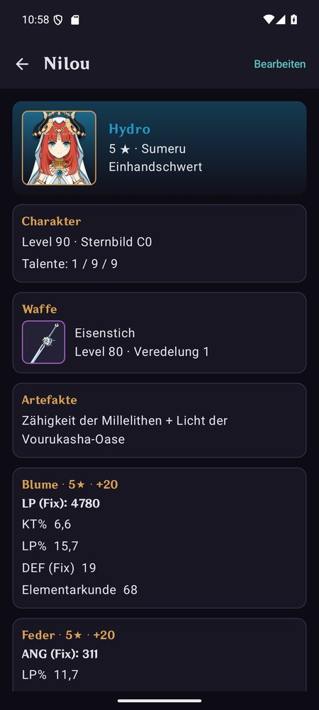

# Genshin Impact – Team & Build Manager

Teams aus bis zu vier Charakteren zusammenstellen und für jeden Charakter einen Build verwalten: Level, Sternbild, Talente, Waffe, Artefaktsets und die Werte aller fünf Artefakte. Es gibt drei Clients für dieselben Daten: eine **Desktop-App**, eine **Web-App** und eine **Android-App**.

<p align="center">
  
</p>

| Desktop | Android: Teams | Android: Build |
|:---:|:---:|:---:|
|  |  |  |

## Funktionen

- **Teams** mit bis zu 4 Charakteren anlegen, speichern, umbenennen und löschen; die Reihenfolge ändert man per Drag & Drop oder mit Pfeilen (Desktop, Web) bzw. mit Pfeilen (Android)
- **Builds pro Charakter:** Level, Sternbild (C0–C6), Talente (A/E/Q), Waffe mit Level und Veredelung, zwei Artefaktsets
- **Artefakt-Details:** je Slot (Blume, Feder, Sanduhr, Kelch, Krone) Seltenheit, Level, Hauptwert und bis zu 4 Substats
- **Suche** und Filter für Charaktere (Region, Element, Seltenheit) und Waffen (Typ, Seltenheit)
- **Austausch** von Builds und Teams zwischen den Clients als JSON-Datei
- **Offline ansehen** (Android): Teams und Builds bleiben auch ohne Verbindung sichtbar

Ein Build gehört zum **Charakter, nicht zum Team**: Kommt ein Charakter in mehreren Teams vor, hat er überall denselben Build.

## Die drei Clients

| | Desktop | Web | Android |
|---|---|---|---|
| **Technik** | Python, PySide6 (Qt) | HTML/JavaScript (Tailwind), PHP | Kotlin, Jetpack Compose |
| **Daten** | lokale SQLite-Datei | MySQL/MariaDB auf dem Server | über die Web-API (Online-Client) |
| **Konten** | ein Nutzer, lokal | Registrierung und Login, Daten je Nutzer | Anmeldung am Web-Konto per Token |
| **Voraussetzung** | Python 3.10+, PySide6 | Webserver mit PHP und MySQL | Android 8.0 oder neuer |
| **Doku** | [desktop/README.md](desktop/README.md) | [web/README.md](web/README.md) | [android/README.md](android/README.md) |

## Schnellstart

**Desktop**

```sh
cd desktop
python -m venv .venv && source .venv/bin/activate
pip install -r requirements.txt
python main.py
```

Beim ersten Start legt die App die Datenbank an und spielt die Stammdaten aus `shared/stammdaten.json` ein.

**Web** (lokal, mit eingebautem PHP-Server; die Datenbank wird per `web/api/config.local.php` konfiguriert, siehe [web/README.md](web/README.md))

```sh
cd web
php -S localhost:8000
```

**Android**

Die fertige APK steht bei den [Releases](../../releases). Zum Selbstbauen den Ordner `android/` in Android Studio öffnen oder `./gradlew :app:assembleDebug` ausführen. Die App braucht eine erreichbare Web-Version als Server.

## Wie die Teile zusammenhängen

```
 Desktop (SQLite) ──┐
                    │   JSON-Datei (Datei → Exportieren / Importieren)
                    ├────────────────────────────────────────────┐
                    │                                            ▼
 Android ── HTTPS + Token ───────────────────►  Web-API (PHP) ── MySQL
                                                      ▲
 Browser ──── HTTPS + Session ───────────────────────┘
```

- **Desktop** arbeitet eigenständig mit seiner lokalen Datenbank. Builds und Teams lassen sich als JSON exportieren und in der Web-Version importieren, und umgekehrt.
- **Web** ist der gemeinsame Server. Browser melden sich per Session an, Apps per Token (`Authorization: Bearer …`, ersatzweise `X-Auth-Token`).
- **Android** greift nie direkt auf die Datenbank zu, sondern nur über die API. Der Datenbankzugang bleibt auf dem Server.

## Aufbau des Repositorys

```
desktop/     Desktop-App (main.py, Qt-Widgets, SQLite-Zugriff)
web/         Web-App
  index.html   komplettes Frontend
  api/         PHP-Endpunkte (JSON-API)
  migrations/  SQL-Änderungen für bestehende Datenbanken
  schema.sql   Schema (aus den Abfragen abgeleitet)
android/     Android-App (Gradle-Projekt)
shared/      Gemeinsame Daten aller Clients
  stammdaten.json          Charaktere, Waffen, Artefaktsets
  assets/images/           Icons und Hintergrund
  assets/zh-cn.ttf         Genshin-Schriftart
  exchange-format.md       Spezifikation des JSON-Austauschs (mit Schema und Beispiel)
deploy/      Upload-Skript für die Web-Version
docs/        Screenshots
```

`web/assets` ist ein Symlink auf `shared/assets`, damit das Frontend seine Bilder unter `/assets/…` findet. Beim Hochladen wird er aufgelöst (das übernimmt das Deploy-Skript).

## Gemeinsame Daten

- **Stammdaten** (`shared/stammdaten.json`): eine Quelle für alle Clients. Der Desktop spielt sie beim Start in SQLite ein, die Android-App liest sie direkt aus den Assets, die Web-Version hat sie in der Datenbank.
- **Bilder** werden über den Namen gefunden: Kleinbuchstaben, Leerzeichen und Bindestriche werden zu `_`, Klammerzusätze fallen weg. „Hu Tao“ → `hu_tao.png`, „Traveler (Dendro)“ → `traveler.png`. Neue Bilder müssen dieser Regel folgen.
- **Austauschformat** (`shared/exchange-format.md`, dazu `exchange-format.schema.json` und `testdata/export-beispiel.json`): `{"format": "genshin-team-manager", "version": 1, "builds": [...], "teams": [...]}`. Änderungen am Format müssen in allen Clients nachgezogen werden.

Ein neuer Charakter oder eine neue Waffe braucht also: einen Eintrag in `shared/stammdaten.json`, ein Bild in `shared/assets/images/` und – auf dem Server – einen Datensatz in der Datenbank.

## Entwicklung

- **Android:** `cd android && ./gradlew :app:testDebugUnitTest` prüft das Austauschformat, die Stammdaten und die Bearbeitungslogik gegen die Referenzdateien in `shared/`.
- **Web:** Es gibt keinen Build-Schritt. PHP-Dateien prüft man mit `php -l web/api/<datei>.php`, das Frontend testet `cd web/tests && npm install && npm test` (Node, jsdom). Wie man die API lokal gegen eine echte MariaDB testet, steht in [web/README.md](web/README.md).
- **Desktop:** Start mit `python desktop/main.py`, Tests mit `cd desktop && python -m unittest discover -s tests -v`.
- **Konventionen:** Oberfläche, Fehlermeldungen und Kommentare sind deutsch. Werte, die per `innerHTML` ins Web-Frontend gelangen, gehen durch `escapeHtml()`.

## Bereitstellung

- **Web-Version hochladen:** `deploy/deploy.sh --dry-run` zeigt, was sich ändern würde, `deploy/deploy.sh` lädt es per FTPS hoch (Zugangsdaten in `deploy/deploy.local.env`, Vorlage: `deploy/deploy.example.env`). Das Skript lädt nur Geändertes hoch, sichert vorher die überschriebenen Dateien und fasst `api/db.php` sowie `api/config.local.php` nie an.
- **Datenbank:** Für den Token-Login der Android-App muss einmal `web/migrations/001_api_tokens.sql` ausgeführt werden.
- **Android-Release:** Signieren und Bauen beschreibt [android/README.md](android/README.md). Die fertige APK hängt am GitHub-Release.

## Persönliche Daten

Diese Dateien enthalten persönliche Daten oder Zugangsdaten und stehen in der `.gitignore`: `desktop/genshin_manager.db` (Teams und Builds), `web/api/config.local.php` (Datenbank), `deploy/deploy.local.env` (FTP), `android/keystore.properties` und `android/release.keystore` (Signierschlüssel). Den Signierschlüssel unbedingt separat sichern.

## Hinweis

Inoffizielles Fanprojekt, nicht mit HoYoverse verbunden. Genshin Impact sowie zugehörige Namen und Bilder sind Eigentum von HoYoverse.
