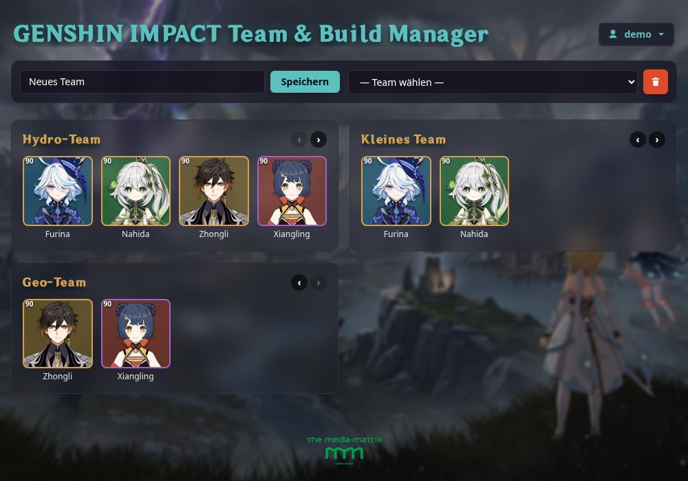
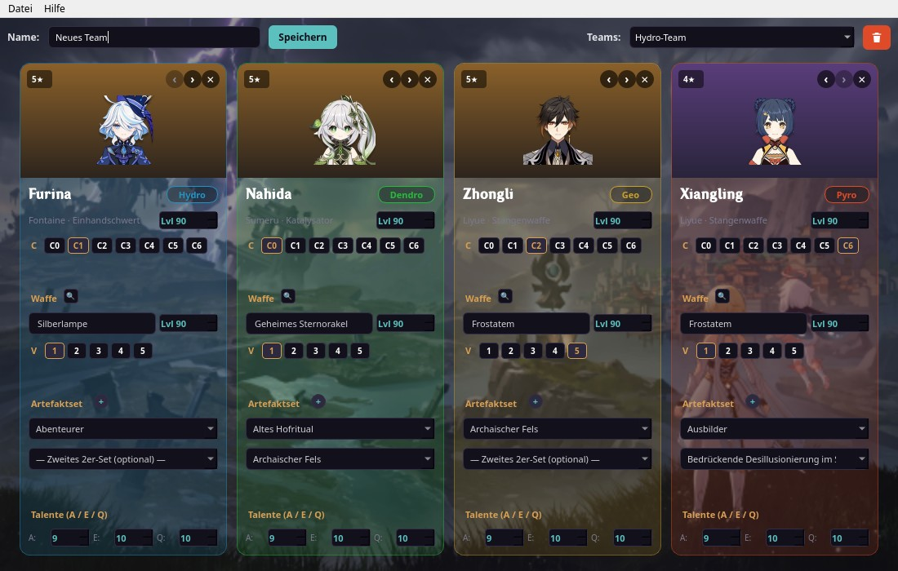
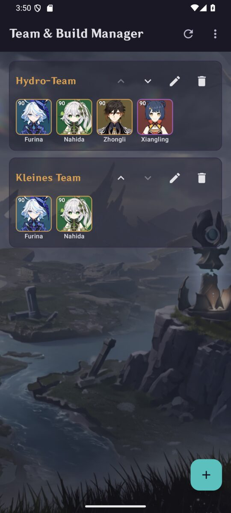
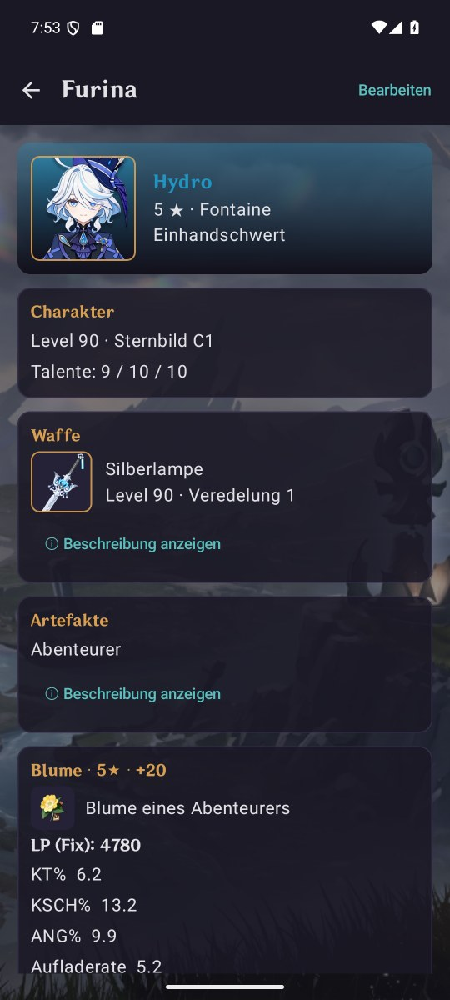
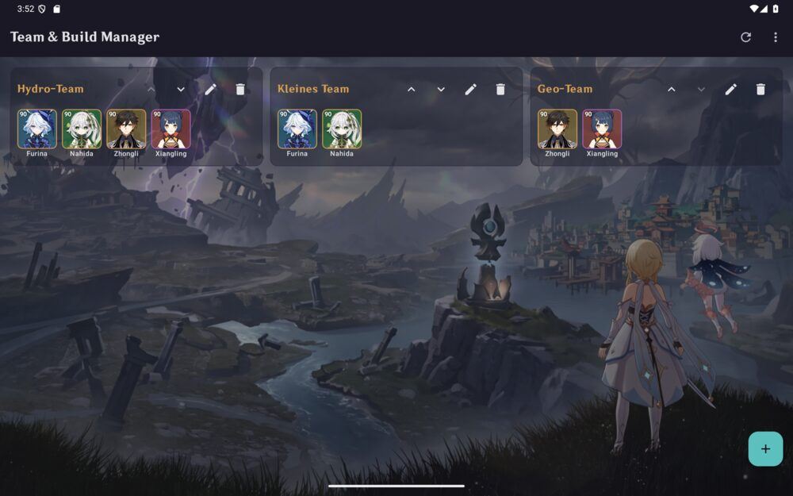

# Genshin Impact – Team & Build Manager

Teams aus bis zu vier Charakteren zusammenstellen und für jeden Charakter einen Build verwalten: Level, Sternbild, Talente, Waffe, Artefaktsets und die Werte aller fünf Artefakte. Es gibt drei Clients für dieselben Daten: eine **Desktop-App**, eine **Web-App** und eine **Android-App**.

<p align="center">
  
</p>

| Desktop | Android (Handy): Teams | Android (Handy): Build |
|:---:|:---:|:---:|
|  |  |  |

<p align="center">
  
</p>

<sub>Alle Screenshots zeigen Beispieldaten eines Demo-Kontos. Weitere Ansichten (Anmeldung, Build bearbeiten, Konto löschen, „Über“-Dialog) stehen in der [Anleitung für Mitspieler](ANLEITUNG.md).</sub>

Du spielst nur mit und willst die App benutzen? Dann geht es hier zur [Anleitung für Mitspieler](ANLEITUNG.md).

## Funktionen

- **Teams** mit bis zu 4 Charakteren anlegen, speichern, umbenennen und löschen; die Reihenfolge der Teams in der Übersicht lässt sich verschieben (Pfeile in allen Clients, in Web und Desktop auch per Drag & Drop) und wird gespeichert
- **Builds pro Charakter:** Level, Sternbild (C0–C6), Talente (A/E/Q), Waffe mit Level und Veredelung, zwei Artefaktsets
- **Artefakt-Details:** je Slot (Blume, Feder, Sanduhr, Kelch, Krone) der Name des Teils (Auswahl aus allen Sets, die Teile der gewählten Sets stehen oben, ein Off-Piece ist möglich), Seltenheit, Level, Hauptwert und bis zu 4 Substats
- **Suche** und Filter für Charaktere (Region, Element, Seltenheit) und Waffen (Typ, Seltenheit)
- **Austausch** von Builds und Teams zwischen den Clients als JSON-Datei
- **Konto anlegen, Passwort ändern und löschen:** Registrierung und endgültiges Löschen des Kontos samt Teams und Builds in Web und Android (Löschen nur nach erneuter Passworteingabe); **Passwort ändern** im Web (im Benutzermenü)
- **Stammdaten aktualisieren** für Administratoren (Web): neue Charaktere und Waffen samt Bildern aus dem Benutzermenü eintragen
- **Handy und Tablet** (Android): Das Handy bleibt im Hochformat (eine Spalte); auf dem Tablet drehbar, mit zwei bis drei Spalten bei den Teams und zweispaltigen Builds
- **„Über“-Dialog** in allen Clients mit Version, Hinweis zum Fanprojekt und dem Logo von the media-matrix
- **Offline ansehen** (Android): Teams und Builds bleiben auch ohne Verbindung sichtbar

Ein Build gehört zum **Charakter, nicht zum Team**: Kommt ein Charakter in mehreren Teams vor, hat er überall denselben Build.

## Die drei Clients

| | Desktop | Web | Android |
|---|---|---|---|
| **Technik** | Python, PySide6 (Qt) | HTML/JavaScript (Tailwind), PHP | Kotlin, Jetpack Compose |
| **Daten** | lokale SQLite-Datei | MySQL/MariaDB auf dem Server | über die Web-API (Online-Client) |
| **Konten** | ein Nutzer, lokal | Registrierung, Login, Passwort ändern und Konto löschen, Daten je Nutzer | Anmeldung, Registrierung und Konto löschen am Web-Konto per Token |
| **Voraussetzung** | Python 3.10+, PySide6 | Webserver mit PHP und MySQL | Android 8.0 oder neuer (Handy und Tablet) |
| **Doku** | [desktop/README.md](desktop/README.md) | [web/README.md](web/README.md) | [android/README.md](android/README.md) |

## Schnellstart

**Desktop**

```sh
cd desktop
python -m venv .venv && source .venv/bin/activate
pip install -r requirements.txt
python main.py
```

Beim ersten Start legt die App die Datenbank an und spielt die Stammdaten aus `shared/stammdaten.json` ein.

**Web** (lokal, mit eingebautem PHP-Server; die Datenbank wird per `web/api/config.local.php` konfiguriert, siehe [web/README.md](web/README.md))

```sh
cd web
php -S localhost:8000
```

**Android**

Eine fertige APK wird nicht verteilt, die App baut man selbst: den Ordner `android/` in Android Studio öffnen oder `./gradlew :app:assembleDebug` ausführen (Details in [android/README.md](android/README.md)). Die App braucht eine erreichbare Web-Version als Server; auf der Anmeldeseite ist das Feld „Server“ mit `https://genshin-manager.media-matrix.de/` vorbelegt (anpassbar, siehe [android/README.md](android/README.md)).

## Wie die Teile zusammenhängen

```
 Desktop (SQLite) ──┐
                    │   JSON-Datei (Datei → Exportieren / Importieren)
                    ├────────────────────────────────────────────┐
                    │                                            ▼
 Android ── HTTPS + Token ───────────────────►  Web-API (PHP) ── MySQL
                                                      ▲
 Browser ──── HTTPS + Session ───────────────────────┘
```

- **Desktop** arbeitet eigenständig mit seiner lokalen Datenbank. Builds und Teams lassen sich als JSON exportieren und in der Web-Version importieren, und umgekehrt.
- **Web** ist der gemeinsame Server. Browser melden sich per Session an, Apps per Token (`Authorization: Bearer …`, ersatzweise `X-Auth-Token`).
- **Android** greift nie direkt auf die Datenbank zu, sondern nur über die API. Der Datenbankzugang bleibt auf dem Server.

## Aufbau des Repositorys

```
desktop/     Desktop-App (main.py, Qt-Widgets, SQLite-Zugriff)
web/         Web-App
  index.html   komplettes Frontend
  api/         PHP-Endpunkte (JSON-API, u. a. auth.php, teams.php, transfer.php, stammdaten.php für Administratoren)
  migrations/  SQL-Änderungen für bestehende Datenbanken (001 bis 011)
  schema.sql   Schema (aus den Abfragen abgeleitet)
android/     Android-App (Gradle-Projekt)
shared/      Gemeinsame Daten aller Clients
  stammdaten.json          Charaktere, Waffen, Artefaktsets
  assets/images/           Bilder nach Typ: characters/, weapons/, ui/ (Hintergrund, Logo, Paimon)
  assets/zh-cn.ttf         Genshin-Schriftart
  exchange-format.md       Spezifikation des JSON-Austauschs (mit Schema und Beispiel)
tools/       update_stammdaten.py (Stammdaten prüfen und ergänzen), remote_sql.py (SQL auf dem Server)
deploy/      Upload-Skript für die Web-Version
docs/        Screenshots
```

`web/assets` ist ein Symlink auf `shared/assets`, damit das Frontend seine Bilder unter `/assets/…` findet. Beim Hochladen wird er aufgelöst (das übernimmt das Deploy-Skript).

## Gemeinsame Daten

- **Stammdaten** (`shared/stammdaten.json`): eine Quelle für alle Clients. Der Desktop spielt sie beim Start in SQLite ein, die Android-App liest sie direkt aus den Assets, die Web-Version hat sie in der Datenbank.
- **Bilder** werden über den Namen gefunden: Kleinbuchstaben, Leerzeichen und Bindestriche werden zu `_`, Klammerzusätze fallen weg. „Hu Tao“ → `characters/hu_tao.png`, „Traveler (Dendro)“ → `characters/traveler.png`, Waffen liegen in `weapons/`. Neue Bilder müssen dieser Regel folgen.
- **Austauschformat** (`shared/exchange-format.md`, dazu `exchange-format.schema.json` und `testdata/export-beispiel.json`): `{"format": "genshin-team-manager", "version": 1, "builds": [...], "teams": [...]}`. Änderungen am Format müssen in allen Clients nachgezogen werden.

Ein neuer Charakter oder eine neue Waffe braucht also: einen Eintrag in `shared/stammdaten.json`, ein Bild in `shared/assets/images/` und – auf dem Server – einen Datensatz in der Datenbank. Das alles erledigt `tools/update_stammdaten.py` (siehe unten) bzw. für Administratoren der Menüpunkt „Stammdaten aktualisieren“.

### Stammdaten auf Aktualität prüfen und ergänzen

Ein Befehl erledigt alles:

```sh
python3 tools/update_stammdaten.py --auto
```

`tools/update_stammdaten.py` vergleicht Charaktere und Waffen mit der öffentlichen Datenquelle [Enka.Network](https://github.com/EnkaNetwork/API-docs), ergänzt Fehlendes in `shared/stammdaten.json`, lädt die Bilder, schreibt eine Migration `web/migrations/NNN_stammdaten_<Datum>.sql`, committet lokal (ohne Push), deployt per `deploy/deploy.sh`, führt die Migration über `tools/remote_sql.py` in der Server-Datenbank aus und prüft zum Schluss über die API, ob alles online ist. Ein zweiter Aufruf meldet „Alles aktuell“, der Befehl eignet sich also für regelmäßige Läufe.

```sh
python3 tools/update_stammdaten.py            # nur prüfen (Exit-Code 1 = es fehlt etwas), ändert nichts
python3 tools/update_stammdaten.py --apply    # nur lokal ergänzen (mit Rückfrage), ohne Deploy und Datenbank
python3 tools/update_stammdaten.py --auto --region "Name=Region"
python3 tools/remote_sql.py web/migrations/<datei>.sql   # eine SQL-Datei (INSERT/UPDATE/DELETE) auf dem Server ausführen
```

Die **Region** kommt aus [genshin-db](https://github.com/theBowja/genshin-db); fehlt sie dort, wird der Charakter nur gemeldet (dann in `shared/regionen.json` als `{"Name": "Region"}` oder per `--region` ergänzen), nie geraten. Charaktere und Waffen, die genshin-db nicht kennt, werden nicht eingetragen (vermutlich noch nicht erschienen); neue Waffen bekommen ihren Passiv-Text von dort. `--auto` bricht bei mehr als 15 neuen Einträgen ab (`--max-new`). Neue Regionen (z. B. Nod-Krai) erscheinen im Region-Filter automatisch.

**Im Web** geht dasselbe für Administratoren über den Menüpunkt „Stammdaten aktualisieren“ im Benutzermenü: Der Dialog listet, was fehlt (bei Charakteren mit der Region aus genshin-db vorausgewählt); ausgewählt wird per Haken. Das ändert nur die Datenbank und die Bilder auf dem Server, nicht `shared/stammdaten.json` im Repository; ein späterer Lauf des Skripts holt das lokal nach. Administratoren stehen in `web/api/admins.local.php` (`<?php return ['benutzername'];`, nicht im Git, wird vom Deploy nie hochgeladen). Die Android-App und der Desktop kennen diese Funktion nicht.

**Wie die Datenbank ohne phpMyAdmin erreicht wird:** Sie ist nur vom Server aus erreichbar. `tools/remote_sql.py` lädt eine einmalige PHP-Datei (`api/_sql_<zufall>.php`) per FTPS hoch und ruft sie per HTTPS auf. Die Datei enthält nur den SHA-256-Hash eines Zufalls-Tokens, nutzt die `api/db.php` des Servers, führt alles in einer Transaktion aus (nur INSERT/UPDATE/DELETE/REPLACE), löscht sich selbst und wird vom Skript per FTP-Liste kontrolliert.

## Entwicklung

- **Android:** `cd android && ./gradlew :app:testDebugUnitTest` prüft das Austauschformat, die Stammdaten und die Bearbeitungslogik gegen die Referenzdateien in `shared/`.
- **Web:** Es gibt keinen Build-Schritt. PHP-Dateien prüft man mit `php -l web/api/<datei>.php`, das Frontend testet `cd web/tests && npm install && npm test` (Node, jsdom). Wie man die API lokal gegen eine echte MariaDB testet, steht in [web/README.md](web/README.md); dort laufen auch `web/tests/api_rate_limit.sh` (Begrenzung der Anmeldeversuche) und `web/tests/api_delete_account.sh` (Konto löschen).
- **Desktop:** Start mit `python desktop/main.py`, Tests mit `cd desktop && python -m unittest discover -s tests -v`.
- **Konventionen:** Oberfläche, Fehlermeldungen und Kommentare sind deutsch. Werte, die per `innerHTML` ins Web-Frontend gelangen, gehen durch `escapeHtml()`.

## Bereitstellung

- **Web-Version hochladen:** `deploy/deploy.sh --dry-run` zeigt, was sich ändern würde, `deploy/deploy.sh` lädt es per FTPS hoch (Zugangsdaten in `deploy/deploy.local.env`, Vorlage: `deploy/deploy.example.env`; Anleitung in [deploy/README.md](deploy/README.md)). Das Skript lädt nur Geändertes hoch, sichert vorher die überschriebenen Dateien und fasst `api/db.php` sowie `api/config.local.php` nie an.
- **Datenbank:** Neue Tabellen kommen über `web/migrations/` (`001_api_tokens.sql` für den Token-Login der App, `002_auth_attempts.sql` für die Begrenzung von Anmeldeversuchen, `003_team_position.sql` für die Reihenfolge der Teams, `004_artifact_pieces.sql` für die Namen der Artefaktteile, `005_weapon_passives.sql` für die Passiv-Beschreibungen der Waffen, `006_stat_vtd.sql` für die Umbenennung DEF → VTD in gespeicherten Builds, `007` bis `011` für neue Charaktere und Waffen bzw. das Entfernen nie erschienener); jede Migration einmal ausführen, am bequemsten mit `python3 tools/remote_sql.py web/migrations/<datei>.sql`.
- **Android-Release:** Signieren und Bauen beschreibt [android/README.md](android/README.md). Eine fertige APK wird nicht veröffentlicht.

## Versionen

Web, Android und Desktop trugen seit 1.6.0 dieselbe Versionsnummer. Aktuell sind **Web 1.8.0** (neu: Passwort ändern, Administrator-Menü), **Android 1.7.2** und **Desktop 1.7.2**. Die Version steht jeweils im „Über“-Dialog (Web: Benutzermenü → Über; Android: Menü ⋮ → Über; Desktop: Hilfe → Über…) und an diesen Stellen im Code, die bei jeder Version zusammen mit dem [CHANGELOG.md](CHANGELOG.md) hochgezählt werden:

| Client | Stelle |
|---|---|
| Web | `web/index.html` (Element `#webVersion`) |
| Android | `android/app/build.gradle.kts` (`versionName`, `versionCode`) |
| Desktop | `desktop/models.py` (`APP_VERSION`) |

Tests prüfen, dass die Versionen in Web und Desktop mit dem jeweils obersten Eintrag des Changelogs übereinstimmen.

## Änderungsverlauf

Siehe [CHANGELOG.md](CHANGELOG.md).

## Persönliche Daten

Diese Dateien enthalten persönliche Daten oder Zugangsdaten und stehen in der `.gitignore`: `desktop/genshin_manager.db` (Teams und Builds), `web/api/config.local.php` (Datenbank), `web/api/admins.local.php` (Administratoren), `deploy/deploy.local.env` (FTP), `android/keystore.properties` und `android/release.keystore` (Signierschlüssel). Den Signierschlüssel unbedingt separat sichern.

## Hinweis

Inoffizielles Fanprojekt, nicht mit HoYoverse verbunden. Genshin Impact sowie zugehörige Namen und Bilder sind Eigentum von HoYoverse.
